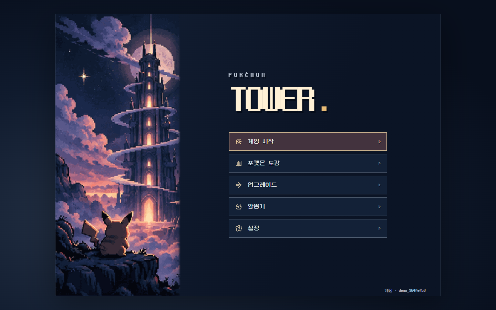
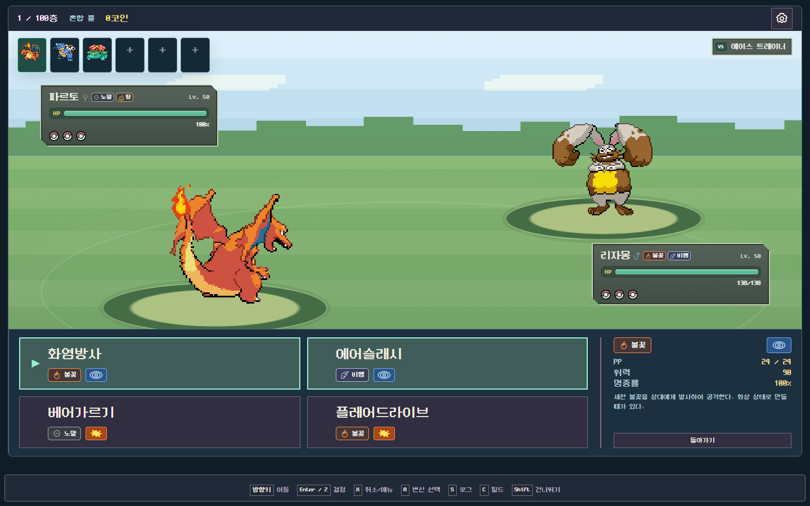
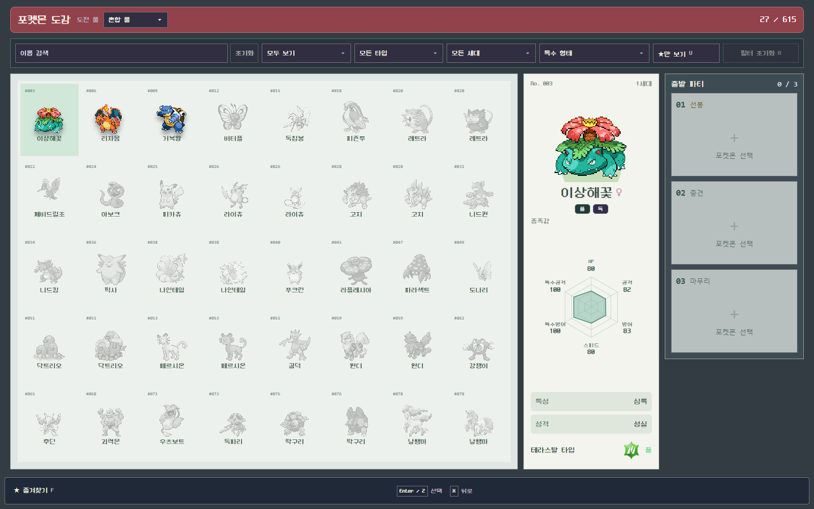
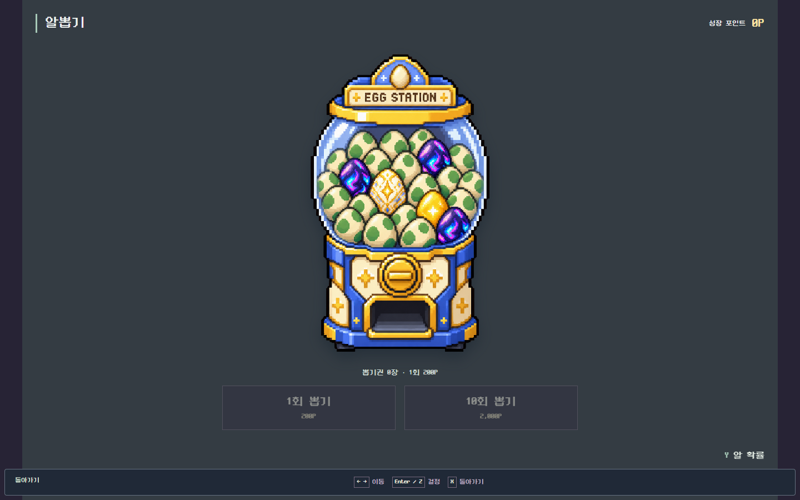
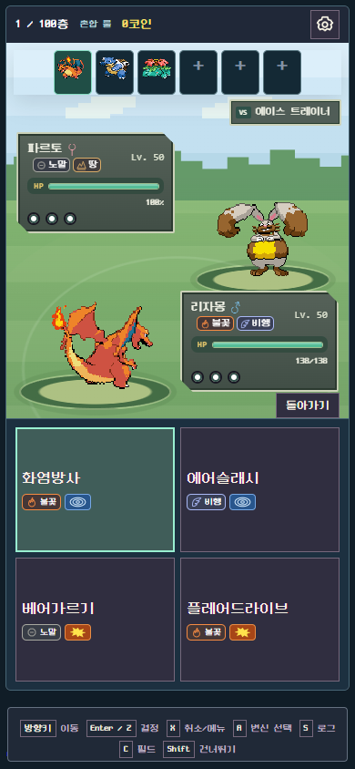

<div align="center">

# Pokémon Tower

**좋아하는 세 마리와 시작하는, 100층 배틀타워.**

관장과 챔피언을 넘어, 타워의 꼭대기까지.

포켓몬을 모으고, 파티를 다듬고, 결정적인 순간에 기믹을 펼치는 포켓몬 팬 게임입니다.

**100층 도전 · 3대3 싱글 배틀 · 다양한 배틀 기믹 · 네임드 트레이너 · 수집과 육성**

[배틀타워](#100층을-향한-도전) · [배틀 기믹](#판을-뒤집는-배틀-기믹) · [트레이너](#익숙한-이름-새로운-승부) · [수집과 육성](#이번-도전이-다음-도전의-힘으로) · [실행 방법](#내-pc에서-실행하기)

</div>



**현재 버전은 v1.0.0-beta.1입니다.** Normal Mode 100층 기준 1차 완성을 마쳤으며, 음향과 기술 이펙트 보강이 남아 있어 베타 버전으로 공개합니다. 앞으로는 UI/UX와 비주얼 디자인, 추가 이벤트와 콘텐츠, 기술 연출과 사운드를 업데이트하고 플레이 피드백을 바탕으로 밸런스를 다듬어 갑니다.

## 100층을 향한 도전

출발은 세 마리입니다. 좋아하는 파트너를 골라 타워에 도전하고, 승리할 때마다 새로운 동료와 기술을 모아 파티를 완성해 보세요. 보유 파티를 최대 여섯 마리까지 늘리고, 다음 상대를 생각하며 출전할 세 마리와 선봉을 고릅니다.

타워는 **전반과 후반, 서로 다른 두 지역 테마**로 이어집니다. 일반 트레이너부터 관장·사천왕·챔피언까지, 한 층씩 올라갈수록 다른 상대와 마주합니다. 50층의 관문을 넘었다면 남은 절반이 기다립니다. 목표는 100층 정상입니다.

**파티·룰 선택 → 배틀 → 보상과 동료 영입 → 출전 준비·정비 → 다음 층**

타입 상성을 맞히는 것만으로 끝나지 않습니다. 기술을 읽고 교체할지, 상태이상으로 흐름을 잡을지, 아껴 둔 기믹을 지금 쓸지 결정하세요. 기술·특성·지닌 도구·날씨와 필드 효과가 맞물리는 턴제 배틀을 즐길 수 있습니다.



## 판을 뒤집는 배틀 기믹

거대한 포켓몬의 한 방, 에이스의 메가진화, 상성을 바꾸는 테라스탈까지. 선택한 룰과 포켓몬·도구·트레이너 장비에 맞춰 기믹을 활용합니다.

| 기믹 | 배틀의 변화 |
|---|---|
| **메가진화** | 메가스톤으로 에이스의 모습·능력치·특성을 바꿉니다. 원시회귀도 지원합니다. |
| **다이맥스·거다이맥스** | 거대한 모습과 다이맥스 기술을 활용합니다. 지원 종은 거다이맥스 모습으로 등장합니다. |
| **테라스탈** | 테라 타입으로 상성과 공격 전략을 바꿉니다. 타입별 테라 아이콘과 변신 연출을 제공합니다. |
| **Z기술** | 알맞은 Z크리스탈로 기술을 강화해 한 번의 결정적인 기회를 노립니다. |

**기본·메가진화·다이맥스·테라스탈·혼합·Z기술**, 여섯 가지 룰로 도전할 수 있습니다. 혼합룰에서는 사용할 기믹과 담당 포켓몬을 나누는 선택도 중요합니다. 사용권과 중첩 제한은 실제 배틀 규칙을 따릅니다.

## 익숙한 이름, 새로운 승부

지역을 대표하는 **관장·사천왕·챔피언과 네임드 NPC**가 타워에서 기다립니다. 대표 에이스와 파티 콘셉트, 기술·특성·지닌 도구, 전술과 기믹을 갖춘 상대에게 도전하세요.

같은 네임드라도 매번 세 마리가 똑같이 나오는 것은 아닙니다. 후보 파티와 선출 규칙을 사용하는 상대는 그 안에서 실제 출전 멤버를 구성합니다. 층과 역할에 맞춘 육성·AI 설정도 적용되어, 상대에 따라 준비와 운영을 바꿔야 합니다.

일반 트레이너 역시 클래스별 파티 콘셉트와 품질을 갖습니다. 어떤 상대는 공격을 밀어붙이고, 어떤 상대는 교체와 상태이상으로 기회를 만듭니다. 플레이어의 비공개 정보를 미리 읽는 대신, 배틀에서 공개된 정보를 바탕으로 판단합니다.

## 층 사이에도 이야기가 있습니다

올라가는 길에 만나는 이벤트가 도전의 흐름을 바꿉니다.

- **미스터리 상자:** 보물일지 함정일지, 열어 보기 전에는 모릅니다.
- **브리더와 여행 상인:** 알뽑기권을 받거나 거래해 다음 파트너를 준비합니다.
- **도전자 선택전:** 상대와 보상을 살펴보고 승부할 트레이너를 고릅니다. 드물게 특별한 Mirror 도전자도 등장합니다.
- **히든상점과 순간이동:** 희귀한 물건을 찾거나 낯선 층으로 이동합니다.
- **빌런 캠페인:** 로켓단을 비롯한 지역별 조직과 조무래기·간부·보스의 연속 승부를 펼칩니다.
- **레이드:** 20종의 강적이 여러 페이즈와 변신으로 맞섭니다. 격파 후 영입과 특별 보상을 노려 보세요.

조건을 만족하면 챕터 끝에서 히든보스와도 마주할 수 있습니다. 이벤트 전투는 일반 등반과 연결되며, 상대·분기·보상은 저장되어 이어하기에서도 유지됩니다.

## 이번 도전이 다음 도전의 힘으로

도전이 끝나도 모은 포켓몬과 기술, 개체값과 육성 기록은 계정에 남습니다. 1~9세대 스타팅 최종 진화형 27종에서 출발해, 승리 후 영입과 알뽑기로 도감을 채워 보세요.

도감의 포켓몬 설정에서 **기술 네 칸·능력 포인트·성격·특성·테라 타입·선택 폼**을 준비합니다. 기술 교체와 칸 맞바꾸기는 무료이며 바로 저장됩니다. 중복 수집도 더 높은 개체값과 새로운 기술을 얻는 기회가 됩니다.

도전 중에는 코인으로 지닌 도구·기술머신·배틀 아이템을 준비하고, 배낭에서 파티에 맞게 배분합니다. 영구 성장 포인트로는 **리롤 확장·재도전 확장·출발 지원금**을 구매해 다음 등반을 준비합니다.



### 알 하나를 여는 즐거움

Egg Station에서 1개 또는 10개를 뽑습니다. 기계가 들썩이고 출구에서 대표 알이 나온 뒤, 알을 하나씩 누르거나 한 번에 부화시킬 수 있습니다.

**일반·레어·슈퍼레어**, 그리고 금빛으로 반짝이는 **이로치 알**. 레어는 준전설·패러독스·울트라비스트, 슈퍼레어는 초전설·환상을 만나는 기회입니다. 이로치는 모든 등급에서 별도로 판정하며, 정확한 확률은 게임 안에서 확인할 수 있습니다.

새 포켓몬을 처음 만났을 때도, 이미 가진 파트너의 개체값이나 기술이 좋아졌을 때도 결과를 확인할 수 있습니다.



## PC에서도, 휴대폰에서도

키보드·마우스·터치와 게임패드 입력을 지원합니다. PC에서는 방향키와 결정·취소 키로 메뉴를 고르고, 휴대폰에서는 화면을 눌러 진행합니다. 배틀 기록·상세 정보·재생 속도·연출 스킵·음량 설정으로 플레이 방식을 조정할 수 있습니다.

같은 서버의 같은 계정으로 로그인하면 도감·육성·재화와 진행 중인 도전을 다른 기기에서도 이어갈 수 있습니다.

<p align="center"></p>

## 내 PC에서 실행하기

### 처음 한 번 · Windows

1. [Node.js 24 이상](https://nodejs.org/)을 설치합니다.
2. 저장소를 다운로드해 압축을 풀거나 clone합니다.
3. **포켓몬타워 설치.cmd**를 더블클릭합니다.

설치 CMD가 pnpm 11.19.0과 프로젝트 의존성을 준비한 뒤 게임을 실행합니다.

### 그 다음부터

**포켓몬타워 로컬 실행.cmd**를 더블클릭하면 됩니다. 서버가 준비되면 브라우저에서 `http://127.0.0.1:3000`을 엽니다. 종료는 CMD 창에서 Ctrl+C를 누릅니다. **로컬 플레이에는 Docker가 필요 없습니다.**

직접 명령어를 사용하려면 Node.js 24 이상과 pnpm 11.19.0을 준비한 뒤 프로젝트 폴더에서 실행합니다.

```sh
pnpm install --frozen-lockfile
pnpm dev
```

개인용 EXE·Docker·임시 접속 터널은 별도의 선택적 실행 방식입니다. 개인 실행 파일·환경변수·저장 DB는 Git에 포함하지 않습니다.

- [처음 설치하고 실행하기](docs/operations/SETUP.md)
- [저장과 백업](docs/operations/BACKUPS.md) · [다른 PC로 옮기기](docs/operations/COMPUTER_MOVE.md)
- [현재 구현](docs/STATUS.md) · [게임 규칙과 조작](docs/gameplay/README.md) · [개발 문서](docs/engineering/README.md)

## 어떻게 만들었나요?

Next.js 16.3.8·React 19.3.0·TypeScript 7.0.2로 만들고, Pokémon Showdown 0.11.11로 배틀을 계산합니다. SQLite에 도감과 진행을 저장하고, 저장된 배틀·이벤트·NPC 정보를 복구해 이어하기를 지원합니다.

상대별 Tactical·Expert 계열 AI를 사용하며, 과거 AI 정책도 보존해 진행 중인 배틀을 이어갑니다. 대량 전투 시뮬레이션과 전투 로그로 NPC·기믹·밸런스를 검증하고, Playwright 1.63.0으로 화면과 입력을 검사합니다. 데이터는 원본 입력 → 검증 → 게임용 내보내기 과정을 거칩니다. Docker를 이용한 실행도 지원합니다.

구조와 검증 도구에 관한 자세한 내용은 [개발 문서](docs/engineering/README.md)에 정리했습니다.

## 앞으로

1차 완성 이후에는 게임의 완성도와 콘텐츠를 확장해 나갑니다.

- UI/UX와 비주얼 디자인 개선
- 새로운 일반 이벤트·Raid·빌런 캠페인·특수 전투
- 기술 이펙트·효과음·BGM 개선
- 플레이 피드백 기반 난이도와 보상 밸런스 조정
- Normal Mode와 별도로 설계할 Hard Mode 검토

ML 기반 AI는 충분한 플레이 데이터를 확보한 뒤 장기 연구 대상으로 검토합니다. 구체적인 방향은 [ROADMAP](docs/current/ROADMAP.md)에서 확인할 수 있습니다.

## 이 프로젝트에 대해

**Normal Mode 100층의 1차 완성을 마친 개인 포켓몬 팬 프로젝트**입니다. 좋아하는 포켓몬으로 파티를 만들고, 익숙한 트레이너들과 배틀하며, 조금씩 강해지는 도전을 직접 만들고 즐기기 위해 시작했습니다. 이후에는 플레이 피드백에 맞춰 난이도와 완성도를 다듬어 갑니다.

개인적으로 즐기기 위한 비공식 프로젝트이며 수익화·공개 서비스 운영을 목적으로 하지 않습니다. 포켓몬 관련 권리는 해당 권리자에게 있습니다. 배틀 계산은 Pokémon Showdown을 바탕으로 하며, 이미지·음원·글꼴 등 사용 자료의 출처와 라이선스는 [출처 안내](docs/references/THIRD_PARTY.md)에 정리했습니다.
