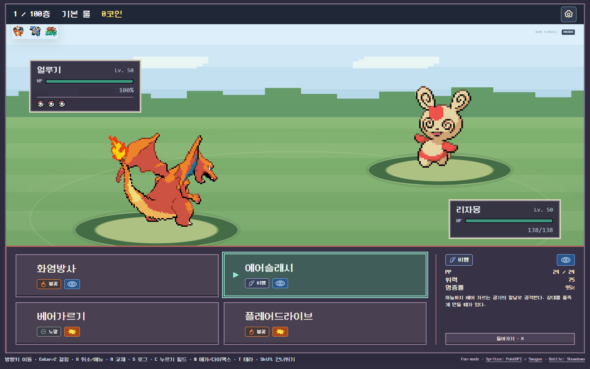
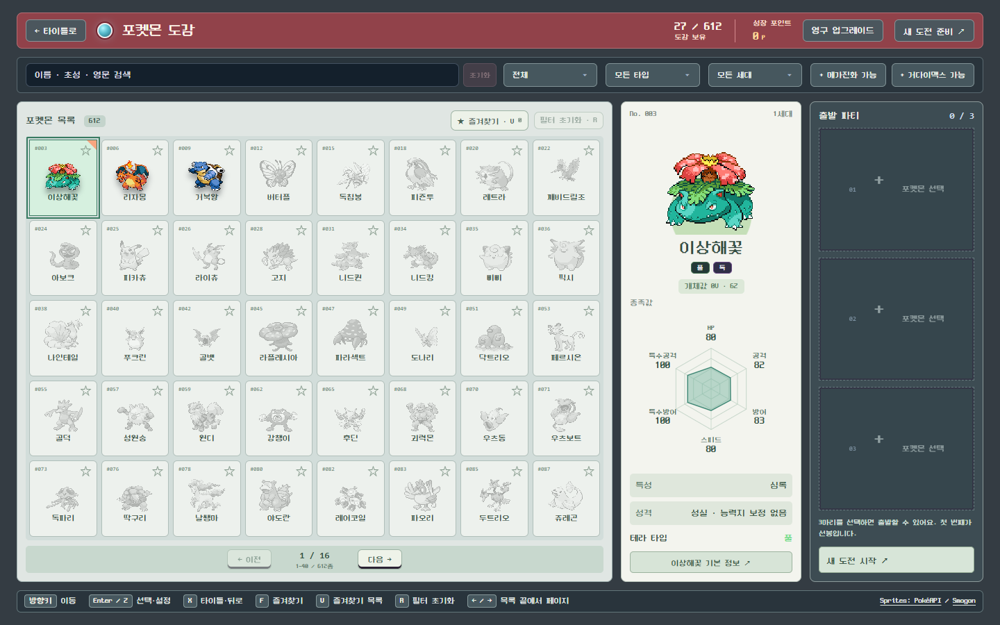
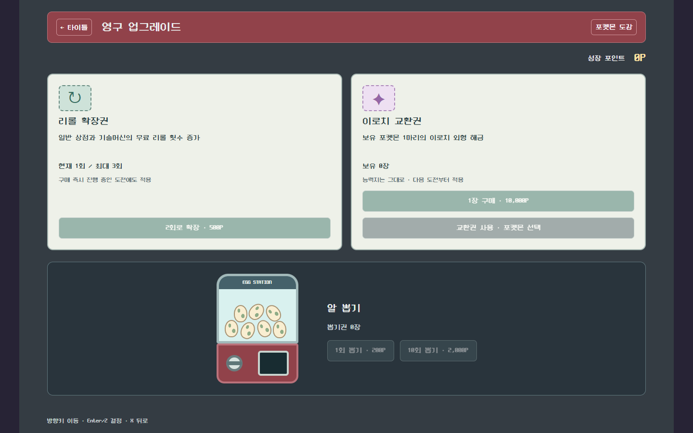
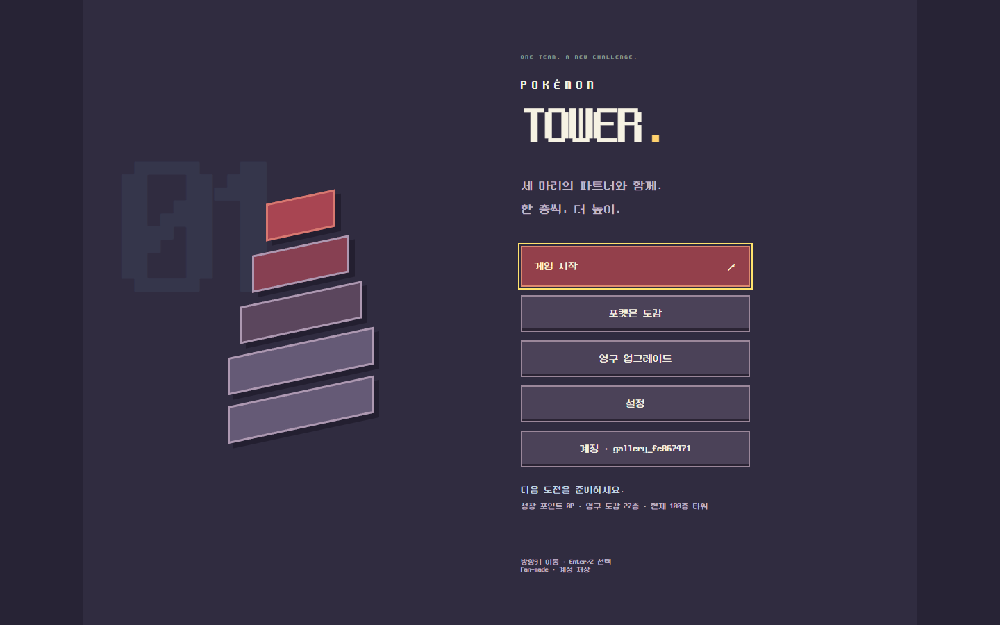
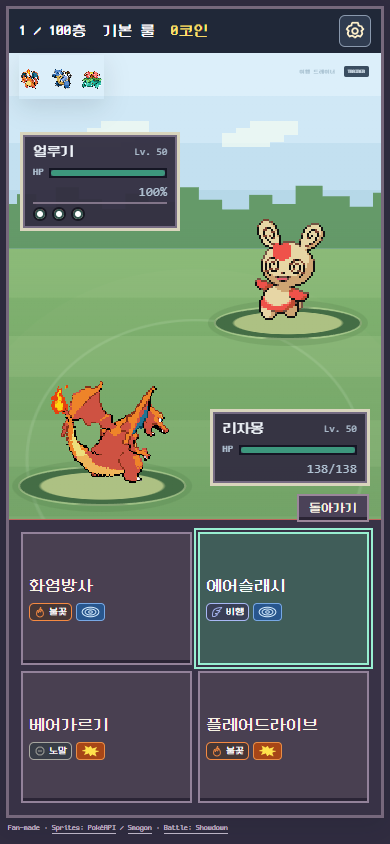

<div align="center">

# Pokémon Tower

**세 마리의 파트너와 함께. 한 층씩, 더 높이.**

포켓몬을 모으고, 나만의 팀을 키우고, 100층 타워에 도전하는 팬 메이드 웹 게임.

**612종 도감 · 3대3 싱글 배틀 · 100층 도전 · PC & 모바일**

[게임 소개](#어떤-게임인가요) · [화면 둘러보기](#화면-둘러보기) · [실행하기](#직접-플레이하기) · [개발 문서](docs/README.md)

</div>



## 어떤 게임인가요?

좋아하는 포켓몬 세 마리로 출발해 한 층씩 상대 트레이너를 돌파합니다. 승리한 상대를 새로운 동료로 데려오거나 도감에 등록하고, 모은 기술과 개체값으로 다음 도전을 준비하세요. 이번 도전이 끝나도 도감과 성장 포인트는 남습니다.

| 수집 | 육성 | 도전 |
|---|---|---|
| 612종 포켓몬과 새로운 기술을 도감에 등록 | 기술배치·노력치·성격·특성·테라스탈 타입 설정 | 3대3 싱글 배틀로 100층까지 등반 |
| 1~9세대 스타팅 최종 진화형 27종으로 시작 | 중복 포켓몬의 높은 개체값을 능력치별로 수집 | 매 도전의 세대 테마와 지역별 네임드·빌런 |
| 알 뽑기와 이로치 외형 해금 | 10층마다 상점에서 도구 구매와 팀 정비 | 기본·메진·다맥·테라·혼합, 다섯 가지 룰 |

### 한 번의 도전은 이렇게 흘러갑니다

**팀 선택 → 룰 선택 → 배틀 → 동료 영입·도감 등록 → 팀 정비 → 다음 층**

타입 상성을 읽고, 교체할 타이밍을 잡고, 기믹을 사용할 순간을 선택하세요. 메가진화·다이맥스·테라스탈은 선택한 룰과 도구 조건에 따라 사용할 수 있습니다.

## 화면 둘러보기

아래 이미지는 2026-10-12에 별도 시연 계정으로 촬영한 실제 게임 화면입니다.

### 나만의 출발 파티

도감에서 이름·타입·세대로 찾고, 즐겨찾는 포켓몬으로 출발 파티를 구성합니다. 기본 정보와 변신 모습도 확인할 수 있습니다.



### 다음 도전을 위한 성장

도전으로 모은 성장 포인트를 알 뽑기, 리롤 확장, 이로치 교환에 사용할 수 있습니다. 포켓몬과 해금한 기술은 계정에 저장됩니다.



### PC에서도, 휴대폰에서도

<table>
<tr>
<td width="68%" align="center"><br><strong>키보드로 빠르게 선택</strong><br>방향키 이동 · Enter/Z 결정 · X 뒤로</td>
<td width="32%" align="center"><br><strong>터치로 플레이</strong><br>기술 길게 누르기: 설명<br>경기 화면 길게 누르기: 날씨·랭크<br>공격 연출 중 두 번 터치: 스킵</td>
</tr>
</table>

한 번 로그인하면 같은 브라우저에서 30일 동안 유지됩니다. 다른 기기에서도 같은 서버의 계정으로 로그인해 저장된 도전을 이어갈 수 있습니다.

## 직접 플레이하기

**Node.js 24 이상 · pnpm 11.19.0**

```sh
pnpm install --frozen-lockfile
pnpm dev
```

[로컬 게임 열기](http://127.0.0.1:3000) → 회원가입 또는 로그인 → 게임 시작.

현재 인터넷 테스트는 PC의 Docker 서버와 무료 Cloudflare Quick Tunnel을 사용합니다. 임시 주소는 바뀔 수 있으므로 이 문서에는 고정 플레이 링크를 두지 않습니다. [Docker·무료 테스트 배포 안내](docs/current/DEPLOYMENT.md)를 참고하세요.

## 개발과 AI 실험

Next.js · React · TypeScript로 화면과 게임 흐름을 구현하고, Pokémon Showdown으로 전투 규칙을 처리합니다. SQLite에 계정·도감·도전 상태를 저장합니다. 상대 AI는 관측한 무효·흡수 정보를 다음 행동 판단에 반영합니다.

```sh
pnpm typecheck
pnpm test
pnpm build
```

AI 비교 실험의 보고서와 재현 자료도 관리합니다. 자동 등반 결과는 사람의 승률과 구분하며, 전체 과거 브라우저 검사가 최신 UI와 일치한다고 가정하지 않습니다.

| 문서 | 내용 |
|---|---|
| [현재 게임 상태](docs/STATUS.md) | 구현된 규칙·가격·검증 범위 |
| [화면과 조작](docs/current/UI_FLOW.md) | PC 키보드와 모바일 터치 흐름 |
| [설치·계정](docs/current/SETUP.md) / [배포](docs/current/DEPLOYMENT.md) | 실행·저장·Docker 운영 |
| [AI 실험](docs/experiments/README.md) / [원자료](artifacts/README.md) | 비교 결과와 상세 분석 자료 |
| [컴퓨터 이전](docs/current/COMPUTER_MOVE.md) / [작업 인계](docs/SESSION_HANDOFF.md) | 다른 컴퓨터에서 개발 이어가기 |

**컴퓨터를 옮길 때:** Git에서 제외된 `artifacts/*-trace.jsonl`, 일부 대용량 audit와 `.data/backups/`는 직접 복사해야 합니다. 계정 백업은 공개 저장소에 올리지 않습니다.

## 출처

비공식 팬 메이드 프로젝트입니다. 포켓몬 관련 권리는 해당 권리자에게 있습니다. 전투 엔진·스프라이트·데이터·음원의 출처는 [자산 및 라이선스 안내](docs/references/THIRD_PARTY.md)에 정리했습니다. Neo둥근모 폰트는 [OFL 라이선스](public/fonts/NEODGM-LICENSE.txt)를 포함합니다.

온라인 대전과 Z기술은 현재 제공하지 않습니다.

