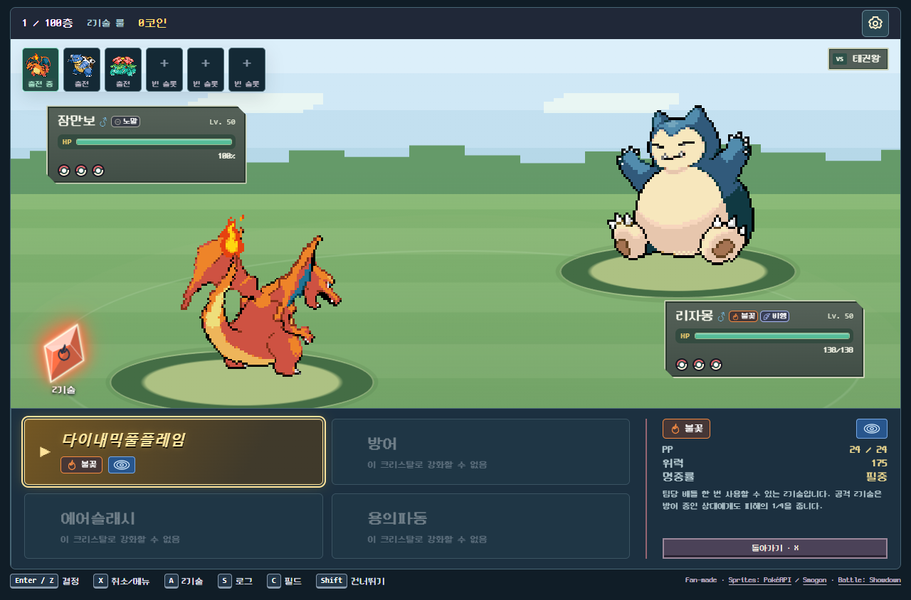

# Pokémon Tower

**세 마리의 파트너와 함께. 한 층씩, 더 높이.**

포켓몬을 좋아하는 마음으로 직접 만들어 보는, 수집·육성·100층 배틀타워 웹 게임.

**615개 도감 항목 · 3대3 싱글 배틀 · 100층 도전 · PC & 모바일**

[게임 소개](#어떤-게임인가요) · [현재 구현](#현재-구현) · [화면 둘러보기](#화면-둘러보기) · [제작 취지와 출처](#제작-취지와-출처)

## 어떤 게임인가요?

좋아하는 포켓몬 세 마리로 출발해 한 층씩 상대 트레이너를 돌파합니다. 승리한 상대를 새로운 동료로 데려오거나 도감에 등록하고, 모은 기술과 개체값으로 다음 도전을 준비하세요. 이번 도전이 끝나도 도감과 성장 포인트는 남습니다.

| 수집 | 육성 | 도전 |
|---|---|---|
| 615개 도감 항목과 새로운 기술을 수집 | 기술배치·능력 포인트·성격·특성·테라스탈 타입 설정 | 3대3 싱글 배틀로 100층까지 등반 |
| 1~9세대 스타팅 최종 진화형 27종으로 시작 | 중복 포켓몬의 높은 개체값을 능력치별로 수집 | 매 도전의 세대 테마와 지역별 네임드·빌런 |
| 알 뽑기와 이로치 외형 해금 | 10층마다 상점에서 도구 구매와 팀 정비 | 기본·메진·다맥·테라·혼합·Z기술, 여섯 가지 룰 |

### 한 번의 도전은 이렇게 흘러갑니다

**팀 선택 → 룰 선택 → 배틀 → 동료 영입·도감 등록 → 팀 정비 → 다음 층**

타입 상성을 읽고, 교체할 타이밍을 잡고, 기믹을 사용할 순간을 선택하세요. 메가진화·다이맥스·테라스탈·Z기술은 선택한 룰과 도구 조건에 따라 사용할 수 있습니다.

## 현재 구현

기본 배틀 시스템과 **팀 준비 → 배틀 → 보상·영입 → 다음 층**의 플레이 흐름을 구현했습니다. 수집·육성·상점과 계정 저장도 연결되어, 한 번의 도전을 진행하고 저장된 게임을 이어갈 수 있는 단계입니다. 현재는 실제 플레이를 확인하며 난이도와 화면 사용성을 다듬고 있습니다.

| 영역 | 구현된 내용 |
|---|---|
| 배틀 | 기술·교체·타입 상성·특성·상태이상, 메가진화·원시회귀·다이맥스·거다이맥스·테라스탈·Z기술 |
| 타워 | 일반 모드 100층, 지역별 트레이너와 빌런 이벤트, 전반·후반 NPC 팀과 육성 |
| 수집·육성 | 도감·영입·알 뽑기, 개체값·기술 수집, 능력치·선택 폼·지닌 도구 관리 |
| 성장·정비 | 코인 상점·기술머신·영양제, 성장 포인트와 영구 업그레이드, 패배 후 다시하기 확장 |
| 저장·조작 | 계정별 진행 저장·배틀 복구, PC·모바일 화면, 키보드·마우스·터치 조작 |

온라인 대전과 하드모드는 구현하지 않았습니다. 현재 기능과 다음 작업은 [프로젝트 안내](docs/README.md)에서 확인할 수 있습니다.

## 화면 둘러보기

### 포켓몬 도감

도감에서 이름·타입·세대로 찾고, 즐겨찾는 포켓몬으로 출발 파티를 구성합니다. 기본 정보와 변신 모습도 확인할 수 있습니다.

### 영구 업그레이드

도전으로 모은 성장 포인트를 알 뽑기, 리롤 확장, 이로치 교환에 사용할 수 있습니다. 포켓몬과 해금한 기술은 계정에 저장됩니다.

### 기믹 활용

메가진화·원시회귀·다이맥스·거다이맥스·테라스탈·Z기술을 구현했습니다. 선택한 룰과 포켓몬·도구에 따라 기믹을 활용하고, 변신 모습과 기술 변화도 배틀 화면에 반영됩니다.

아래는 Z기술 선택 화면의 예시입니다. 크리스탈로 강화할 수 있는 기술명과 버튼을 금빛으로 강조해 사용 가능한 기술을 구분합니다.

### PC에서도, 휴대폰에서도

<table>
<tr>
<td width="68%" align="center"> <strong>키보드로 빠르게 선택</strong> 방향키 이동 · Enter/Z 결정 · X 뒤로</td>
<td width="32%" align="center"> <strong>터치로 플레이</strong> 기술 길게 누르기: 설명 경기 화면 길게 누르기: 날씨·랭크 공격 연출 중 두 번 터치: 스킵</td>
</tr>
</table>

계정별로 도감·육성·재화와 진행 중인 도전을 저장합니다. 같은 서버의 같은 계정으로 로그인하면 다른 기기에서도 이어갈 수 있습니다.

## 제작 취지와 출처

포켓몬을 좋아하는 마음으로, 직접 만들고 즐기기 위해 시작한 개인 팬 프로젝트입니다. 수익화나 공개 서비스 운영을 목적으로 하지 않으며, 이곳에 제작 과정을 기록하고 있습니다.

공식 프로젝트와는 관련이 없으며, 포켓몬 관련 권리는 해당 권리자에게 있습니다. 사용한 코드·이미지·음원 등의 출처는 [자산 및 라이선스 안내](docs/references/THIRD_PARTY.md)에 정리했습니다. Neo둥근모 폰트의 [OFL 라이선스](public/fonts/NEODGM-LICENSE.txt)도 함께 포함합니다.

[개발 문서](docs/README.md)

