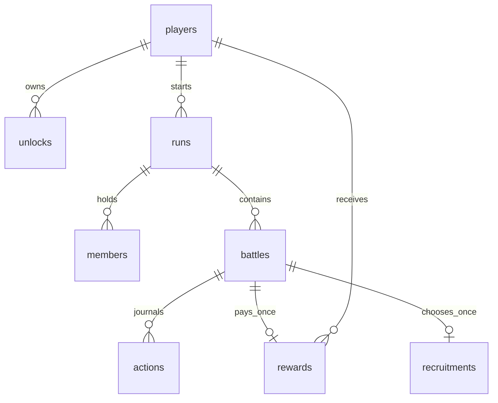

> 문서 범위: 아래 내용과 검증 수치는 작성 당시 기록이다. 현재 기능·층수·가격·키 조작·상대 AI는 [STATUS](../STATUS.md), 후속 작업은 [ROADMAP](../current/ROADMAP.md), 실험 적용 상태는 [EXPERIMENTS](../experiments/README.md)를 먼저 확인한다.

# 데이터와 복구

최종 문서 갱신: 2026-10-10. 구현: `src/server/schema.ts`(v21), `tower-store.ts`(SQL/트랜잭션·마이그레이션), `tower-service.ts`(엔진 연결).
v19는 팀 공용 `run_tera_tickets`, 상점별 `tera_purchases`, 배틀 시작 재고 `battles.tera_tickets`를 추가한다. 테라 사용 행동과 재고 차감은 같은 트랜잭션이다. 이전 배틀은 재고0·종전 포맷으로 복구한다. [상세](../gameplay/TERASTALLIZATION.md).

v20은 `run_villain_campaigns`와 `battles.villain_event`를 추가한다. 보스 승리 시 캠페인 종료와 합산 보상 지급을 배틀 완료와 같은 트랜잭션에서 처리한다. 기존 도전에 새 캠페인을 소급 부여하지 않는다. [빌런 상세](../gameplay/VILLAIN_EVENTS.md).

v21은 새 도전의 목표를 100층으로 설정하고 `run_progression`을 추가한다. 부모 runs 테이블을 재구성할 때 기존 목표 층·자식 데이터·외래키를 보존하고 무결성을 검사한다. 이전 도전은 종료 층과 이후 상대 생성 규칙을 유지한다. [100층 상세](../gameplay/HUNDRED_FLOORS.md).

파일: 기본 `.data/tower.sqlite`. WAL·외래키·STRICT 테이블을 사용한다.

| 테이블 | 역할 | 주요 무결성 |
|---|---|---|
| players | 현재 도전용 코인·영구 성장 포인트·게스트 식별 해시 | coins/growth_points 음수 불가 |
| unlocks | 다음 도전에서 선택 가능한 종 | 플레이어+종 유니크 |
| runs | 층·진행 상태·도전별 목표 층 수 | 플레이어당 활성 도전 1개, total_floors 1~100 |
| run_progression | 새 도전의 생성 규칙 버전 | 도전 기본키, hundred-floor-v1; 기존 도전은 행 없이 legacy 유지 |
| members | 이번 도전의 보유 멤버 | 6개 슬롯, 종 중복 불가 |
| battles | 초기 팀·시드·버전·보상 스냅샷·완료 로그 | 도전+층 유니크 |
| actions | 처리 전에 저장하는 사람 입력 | 배틀+요청 번호 기본키 |
| rewards | 이미 지급한 보상 원장 | 배틀 기본키 |
| recruitments | 영입/교체/생략 결정 | 배틀 기본키 |
| run_upgrades | 소모품 8종의 팀 강화와 적용 층 구간 | 도전+종류 기본키 |
| machine_shops | 체크포인트별 기술머신 상품·가격·학습 대상 스냅샷 | 도전+층 기본키 |
| run_themes | 새 도전의 테마 식별자 | 도전 기본키, 기존 도전은 행 없이 종전 규칙 유지 |
| item_shops | 층별 랜덤 도구 상품 목록 | 도전+층 기본키 |
| run_item_bag | 도전별 도구 가방 수량 | 도전+도구 기본키 |
| run_held_items | 종별 장착 도구 | 도전+종 기본키 |
| item_purchases | 층별 도구 구매 원장 | 도전+층+도구 기본키 |
| machine_purchases | 기술머신 구매 종·장착 칸·실제 가격 | 도전+층+기술 기본키, 상품 목록 외래키 |
| consumable_shops | 체크포인트 소모품 3종 저장 | 도전+층 기본키 |
| shop_rerolls | 도구/TM별 리롤 횟수 | 도전+층+종류 기본키, 횟수 음수 불가 |
| shop_receipts | 리롤 세대별 상품 구매·대상 | 도전+층+종류+세대+상품 기본키 |
| vitamin_shops | 영양제 4종 저장 | 도전+층 기본키 |
| vitamin_purchases | 구매한 능력치·종·실제 가격 | 도전+층+능력치 기본키 |
| run_stat_boosts | 종별 도전 전용 추가 포인트 | 도전+종+능력치 기본키, 포인트 음수 불가 |
| growth_rewards | 도전 종료 성장 포인트 정산 | 도전 기본키, 중복 정산 방지 |
| pokemon_training | 종별 개체값·포인트·성격·특성·기술 프로필과 revision | 플레이어+종 기본키, revision 양수 |
| move_unlocks | 종별 영구 수집 기술 | 플레이어+종+기술 기본키 |
| favorites | 도감 즐겨찾기 | 플레이어+종 기본키 |

전투 팀과 로그는 엔진의 직렬화 자료로 저장하고, 돈·해금·멤버·보상은 관계형 행으로 관리한다.
v11의 `battles.trainer`는 일반·엘리트의 이름·초상화·역할 스냅샷이다. 보스 보너스에 사용하는 `boss`와 분리한다. 기존 경기의 nullable trainer는 그대로 두고 파티를 재생성하지 않는다.
입력 요청 번호는 턴 번호와 다르다. 기절 후 교대도 독립된 요청 번호를 가진다.

## 실제 검증

- 돈 갱신에 테스트용 DB 트리거 오류를 일으켜 결과·보상 원장·지갑·진행 상태가 모두 롤백되는지 확인.
- 완료 콜백 반복 시 보상 한 번, 영입 요청 반복 시 층 증가 한 번.
- 6마리 경계 교체, 미해금 출발·다른 소유자·중복 출전 거부.
- SQLite 파일을 닫고 다시 열어 진행 상태 복구.
- 마지막 행동 기록 후 완료 처리 전 중단 상황에서 재생과 보상 1회 지급.
- 별도 Node.js 서버를 실제 종료·재시작해 HTTP 응답의 배틀 ID·요청 번호·팀 HP·상대 상태가 일치하는지 확인.

## 아직 없는 기능

계정 로그인/게스트 저장 이전, PostgreSQL 마이그레이션, 다중 서버의 배틀 소유권·분산 잠금은 아직 구현하지 않았다. 현재 지원 스키마 버전은 18이다.

v18은 consumable_shops를 추가하고 run_upgrades의 허용 종류를 8종으로 확장한다. v17의 구매 강화·배틀·코인을 보존하며 제약 테이블을 재구성한다.

v17은 리롤 횟수/세대별 구매·영양제 목록/구매·도전 전용 능력 포인트 테이블을 추가했다. 상품 JSON만 갱신해 기존 구매 기록과 부모 외래키를 유지한다. 영양제 포인트는 영구 도감 프로필과 분리하고 배틀 직렬화 메타데이터에 포함해 재현한다.

v16은 run_themes를 추가한다. 새 도전에만 johto를 저장하고 기존 도전에는 테마를 소급 적용하지 않는다.

v15는 runs의 종료 층 상한·기본값을 50으로 확장한다. 기존 행의 종료 층·프로필·연결된 배틀·상점·구매 내역을 복사하고 외래키 무결성을 확인한다. 기존 도전의 종료 층은 바꾸지 않는다.

v14는 item_shops(도전·상점 층별 추첨 상품)를 추가한다. 최초 조회 시 서로 다른 4종을 저장하고 새로고침·재접속에서도 유지한다. 판매 목록 밖의 구매를 서버에서 거절한다. v17 이후 유료 코인 리롤은 구현했다. 상품 제외·성장 포인트 리롤권 구매 저장은 아직 기획이다.

v13은 run_item_bag(도전 가방), run_held_items(종별 장착), item_purchases(층별 구매 원장)를 추가한다. v12 저장의 팀·행동·코인을 변경하지 않는다. 구매·차감·교체·회수는 트랜잭션으로 처리하고 배틀에는 생성 당시 도구를 저장한다. 완료된 배틀의 엔진 이벤트로 소모를 한 번 정산한다. [지닌 도구](../gameplay/HELD_ITEMS.md) 참고.

v10은 기술머신 상품 목록·구매 원장 테이블을 추가한다. 상품 목록은 체크포인트를 처음 조회할 때 한 행으로 저장해 기존 6층 준비 저장에도 대응한다. 구매 시 코인 차감·구매 원장·종별 기술 해금·선택적 도전 세팅 변경을 한 트랜잭션으로 처리한다. 도감의 기본 기술배치는 변경하지 않는다.

runs.profiles는 현재 도전의 세팅 스냅샷, battles.boss/upgrades는 생성 당시 보스·강화 스냅샷, recruitments.iv_gain/move_gain은 영입 성장·기술 획득 기록이다. 영구 도감 세팅을 수정해도 진행 중 배틀의 저장 팀을 다시 만들지 않는다. 일반 NPC 샘플은 배틀 ID로 화면에서 선택하므로 별도 보스 행을 추가하지 않는다.

## v1 → v2

트랜잭션 안에서 runs.total_floors를 추가한다. 기존 행은 3, 새 도전 생성은 10을 명시한다.
클리어 판정은 현재 데이터 파일의 층 수 대신 도전에 저장된 목표 층 수를 사용한다.
기존 배틀의 직렬화 팀·시드·버전·보상·행동 기록은 변경하지 않는다. 3층 클리어 기록을 10층 도전으로 다시 열지 않는다.
테스트에서 실제 v1 형태의 DB와 진행 중 입력을 만든 뒤 마이그레이션·같은 배틀 복구·지갑 보존·새 10층 도전 생성 확인.

2026-10-10 지역 테마 확장: DB v20을 유지한다. 새 run_themes 값은 kanto/johto/hoenn/sinnoh/unova/kalos/alola/galar/paldea 중 하나다. 기존 johto 및 행 없는 도전은 유지한다. run_villains는 새 도전의 지역 후보에서 정한 조직을 저장한다. 이미 저장한 상대 팀·인물·조직·AI 버전을 다시 추첨하지 않는다.
