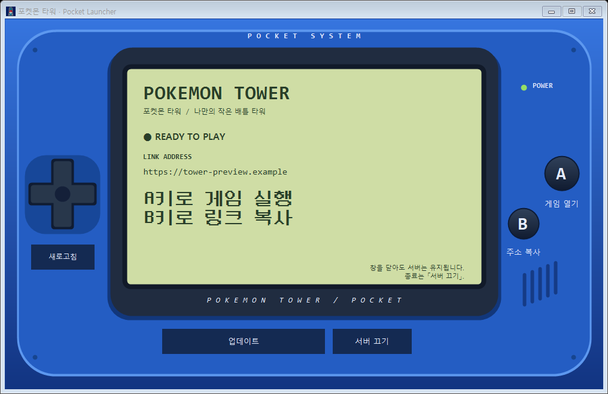

# 설치와 실행

2026-10-21 기준. 현재 결과물은 615개 도감 항목·100층 타워·여섯 룰 선택·1~9세대 랜덤 테마·타이틀·설정과 터미널 배틀이다. 지갑·도감·도전·배틀 행동은 SQLite에 저장하며 Node.js 서버가 전투 엔진을 실행한다.

## Windows에서 더블클릭으로 플레이

### 처음 한 번

1. [Node.js 공식 다운로드](https://nodejs.org/)에서 **Node.js 24 이상**을 설치한다. npm이 포함된 공식 설치 프로그램을 사용하고 Node.js를 PATH에 추가한다.
2. 저장소를 다운로드해 압축을 풀거나 Git으로 clone한다.
3. 프로젝트 루트의 **`포켓몬타워 설치.cmd`를 더블클릭**한다.

설치 CMD는 Node.js·npm을 확인하고 pnpm **11.19.0**을 준비한 뒤 `pnpm install --frozen-lockfile`을 실행한다. pnpm이 없거나 다른 버전이면 `npm install --global pnpm@11.19.0`으로 맞추고, 이미 같은 버전이면 재설치하지 않는다. 패키지를 내려받으므로 처음 설치에는 인터넷 연결이 필요하다.

설치에 성공하면 기존 `포켓몬타워 로컬 실행.cmd`를 호출해 게임을 실행한다. 실패한 단계의 오류를 표시하고 창을 유지한다. Node.js가 없거나 24 미만이면 설치·업데이트를 안내하고 종료하며, Node.js 자체를 설치하거나 관리자 권한을 자동으로 요청하지 않는다.

### 그 다음부터

**`포켓몬타워 로컬 실행.cmd`를 더블클릭**한다. 외부 터널 없이 로컬 개발 서버를 켜고 준비되면 `http://127.0.0.1:3000`을 브라우저로 연다. 종료는 CMD 창에서 Ctrl+C를 누른다. **로컬 플레이에는 Docker가 필요 없다.**

두 CMD는 Git에 포함하며 자신이 있는 프로젝트 폴더를 기준으로 동작한다. 설치 CMD를 다시 실행해도 의존성을 확인·동기화하며 `.env.local`·`.data`·SQLite 저장을 삭제하거나 초기화하지 않는다. 설치 후 게임 실행은 기존 서버의 정상적인 저장·이어하기 경로를 사용한다. 기존 로컬 개발 저장과 개인 통합 실행기의 Docker 저장은 별개다.

## 수동 설치 / 개발자 실행

### 새 PC의 준비물

기존 작업·계정을 다른 PC로 옮길 때는 [컴퓨터 이전 안내](COMPUTER_MOVE.md)를 먼저 따른다. 폴더 복사만으로 Docker 볼륨이 이전되지는 않는다.

1. [Node.js 공식 다운로드](https://nodejs.org/en/download)에서 Node.js를 설치한다. package.json은 24 이상을 요구한다.
2. [Git](https://git-scm.com/downloads)을 설치하고 저장소를 받는다.
3. 터미널을 새로 열어 아래 명령으로 확인한다. Node 설치 시 npm이 포함된 배포본을 사용한다.

```powershell
node --version
npm.cmd --version
git --version
```

Node.js만 시스템에 설치하면 TypeScript·tsx·Showdown은 프로젝트 의존성으로 설치된다.
로컬 개발에는 Docker가 필요 없다. 현재 무료 인터넷 테스트를 이어갈 경우 Docker Desktop과 Linux 엔진이 필요하다. PostgreSQL·별도 게임 엔진 프로그램은 설치하지 않는다.

### 의존성 설치

저장소 루트에서 실행한다. pnpm 11.19.0을 고정해 사용한다.

```powershell
npm.cmd install --global pnpm@11.19.0
pnpm.cmd install --frozen-lockfile
```

pnpm-workspace.yaml은 TypeScript 실행 도구에 필요한 esbuild 빌드만 허용한다.
Showdown이 선택적으로 사용하는 SQLite 네이티브 모듈은 사용하지 않아 빌드를 비활성화했다. 우리 저장 계층은 Node.js 내장 `node:sqlite`를 사용하므로 별도 DB 설치나 네이티브 패키지 빌드가 필요 없다.
향후 DB 기능을 추가할 때 필요한 의존성과 라이선스를 다시 확인한다.

### 실행과 검증

```powershell
# 브라우저로 플레이: 실행 후 http://127.0.0.1:3000 접속
pnpm.cmd dev
```

개발 서버는 파일 변경을 반영한다. 터미널을 닫거나 Ctrl+C를 누르면 서버가 종료된다.
실행 중인 서버 하나가 웹 화면 제공과 전투 API 처리를 모두 담당한다.

프로덕션 빌드와 브라우저 자동 검증:

```powershell
pnpm.cmd build
pnpm.cmd start
# 별도 테스트 서버를 자동 실행. 현재 E2E 설정은 설치된 Google Chrome 사용.
pnpm.cmd test:e2e
```

2026-10-12 Windows 빌드: `pnpm build`는 프로젝트의 `scripts/windows-build-links.cjs`를 빌드 프로세스에만 적용한다. pnpm의 상대 경로 폴더 링크를 Next standalone에 복사할 때 권한 오류가 나면 Windows junction으로 생성한다. 관리자 실행·Windows 개발자 모드를 요구하지 않으며 Linux 빌드에는 영향을 주지 않는다.

포켓몬 이미지는 `public/vendor/pokeapi/pokemon/`와 기존 Showdown·기믹·트레이너 폴더에서 제공한다. 정상 플레이 중 외부 이미지 사이트에 접속할 필요가 없다. 원본을 다시 가져올 때만 `node --import tsx scripts/import-local-pokemon-sprites.ts`를 실행하며 네트워크가 필요하다.

E2E는 3001번 포트에 전용 서버를 시작하고 `.data/e2e.sqlite`를 사용한다. 실제 플레이용 3000번 서버와 DB는 건드리지 않는다.
서버 재시작 테스트는 3002번 포트와 `.data/restart-tests/`의 별도 DB를 사용한다.
테스트 전에 최신 코드를 빌드하고 3001·3002번 포트를 비워 둔다. Chrome이 없다면 설치하거나
Playwright 설정의 channel을 제거한 후 `pnpm.cmd exec playwright install chromium`으로 테스트 브라우저를 설치한다.

기존 CLI와 타입·핵심 테스트:

```powershell
# 사람이 번호를 입력해 AI와 대결
pnpm.cmd battle

# 양쪽 모두 규칙 AI로 한 경기 실행
pnpm.cmd battle:auto

# 타입 검사와 테스트
pnpm.cmd typecheck
pnpm.cmd test

# 경기 종료 시 출력된 실제 로그 파일 경로 사용
pnpm.cmd battle --replay logs/battle-실제파일명.json
```

처음에는 고정된 3마리 순서를 확인하고, 각 요청에서 표시된 행동 번호를 입력한다.
기절한 포켓몬은 교대가 필요하다. 종료는 Ctrl+C다.
경기 완료 시 logs/에 초기 팀·시드·엔진 버전·관측·행동·결과 JSON이 생성된다.
이 로그에는 양쪽 초기 팀 정보가 있으므로 향후 웹 클라이언트나 AI에 그대로 제공하면 안 된다.
웹 완료 로그는 이제 SQLite의 battles.log에 저장한다. 이전 버전의 logs/web 파일은 그대로 남겨 둔다.
CLI 로그 재현과 별개로, 웹은 저장된 초기 팀·시드·엔진/AI 버전·행동을 사용해 중단된 배틀을 복구한다.

## 개인용 통합 실행기와 원격 접속

이 섹션은 개발자 개인 환경에서 사용하는 선택적 실행 방식이다. 일반적인 로컬 플레이에는 필요하지 않다.

이 PC처럼 Node.js 24와 Docker Desktop이 준비되어 있으면 프로젝트 루트의 **`포켓몬타워 실행.exe`를 더블클릭**한다. 실행 폴더로 이동하거나 명령어를 입력할 필요가 없다.

`포켓몬타워 실행.exe` **하나**로 통합 실행기 창을 연다. 창이 열리면 현재 서버 상태와 주소를 자동 확인한다.

EXE는 검은 콘솔 창 없이 실행기 창만 연다. 프로젝트 폴더 안에 두고 사용하며 `scripts/` 등 나머지 파일도 필요하다.


`포켓몬타워 실행.exe`와 개인 실행기용 `포켓몬타워 실행.cmd`는 Git에서 제외한다. Node.js·Docker가 준비된 다른 Windows PC에서는 최신 프로젝트를 받은 뒤, 따로 챙긴 같은 EXE를 `package.json` 옆에 넣고 실행하면 된다. PC마다 다시 만들 필요는 없다. EXE를 가져오지 못했거나 진입점 소스를 수정했을 때는 아래 생성 명령으로 만든다. 소스와 빌드 스크립트는 Git으로 관리한다.

EXE는 프로젝트의 실행기 창을 여는 진입점이며 게임·실행 환경·개인 저장을 포함하지 않는다. 기존 플레이 기록은 별도 복원이 필요하다. 다른 PC로 옮기는 순서와 EXE의 역할은 [컴퓨터 이전](COMPUTER_MOVE.md#실행-환경이-준비된-다른-pc에서-exe-사용)을 따른다.

실행기는 파란 휴대용 게임기 본체와 연두색 LCD 화면을 사용한다. 가운데 화면에는 상태·주소와 간단한 안내만 표시한다. 서버 준비 중에는 A/B 안내를 숨기고, 준비가 끝나면 Neo둥근모 도트 글꼴로 「A키로 게임 실행 / B키로 링크 복사」를 크게 표시한다. 아래 버튼은 서버가 꺼져 있으면 「서버 켜기」, 켜져 있으면 「업데이트」로 표시한다. 왼쪽 새로고침 버튼 또는 R키로 상태를 다시 확인한다. 십자키 그림은 장식이다.



위 화면은 주소·상태를 넣은 렌더링 예시다. 실제 접속 주소는 실행기의 현재 상태를 확인한다.

| 버튼 | 동작 |
|---|---|
| 서버 켜기 (서버 꺼짐) / 업데이트 (서버 실행 중) | Docker 자동 시작 → 최신 게임 빌드 → 기존 DB 백업 → 서버·임시 터널 실행 |
| 서버 끄기 | 게임과 터널 종료. 저장 볼륨 보존 |
| 상태 새로고침 | 현재 실행 상태와 게임 주소 재확인 |
| 게임 열기 | 현재 게임 주소를 브라우저로 열기 |
| 주소 복사 | 현재 주소를 복사. 카톡·문자 등에 붙여넣어 전달 가능 |

QR코드나 별도 주소 단축 서비스는 사용하지 않는다. 처음 실행하거나 코드가 바뀌었으면 빌드에 시간이 걸린다. 이미 최신이면 Docker 빌드 캐시를 사용한다. 상세 과정과 스크롤은 화면에 표시하지 않는다. 오류가 나면 작업 종류·시간·실행 환경·표준 출력과 오류 출력을 `.data/launcher-logs/launcher-날짜-식별자.log`에 저장하고 「오류 로그 열기」를 표시한다. 정상 작업은 로그 파일을 만들지 않는다. 이 폴더는 Git에서 제외되며 임시 출력 정리로 삭제하지 않는다.

작업 중 중복 실행과 이전 주소 복사를 막는다. 창을 닫아도 게임 서버는 유지된다. 종료할 때에는 창을 다시 열고 「서버 끄기」를 누른다. SQLite DB는 서버가 함께 열며 별도 DB 프로그램을 켜지 않는다.

주소는 `.data/preview-url.txt`에도 저장된다. PC와 휴대폰에서 그 주소로 접속한다. PC와 Docker가 켜져 있어야 하며, 터널을 다시 만들면 주소가 달라질 수 있다. 기존 `tower-preview` 저장을 유지하며 로컬 개발의 `.env.local` DB와 자동으로 복사·병합하지 않는다. 실행 전 백업은 Docker 볼륨의 `/data/backups/before-launch-*.sqlite`에 보관한다.

화면은 Windows 기본 WinForms를 사용하는 [launcher-window.ps1](../../scripts/launcher-window.ps1)이다. 별도 GUI 라이브러리를 설치하지 않는다. 서버 실행은 [launch-preview.mjs](../../scripts/launch-preview.mjs), 서버·터널 절차는 [preview.mjs](../../scripts/preview.mjs)다. Node.js가 일반 PATH에 없으면 이 PC의 Codex 런타임도 찾아서 사용한다. 새 PC에서 두 런타임 모두 없으면 Node.js 24를 설치한다. Docker는 PATH·사용자 설치·Program Files 설치를 확인한다.

EXE 진입점 소스는 [windows-launcher.cs](../../scripts/windows-launcher.cs)이다. 수정 후에는 Windows .NET Framework 컴파일러로 다시 만든다.

본체·화면 배치는 PowerShell, 둥근 A/B 버튼 그리기는 [pocket-button.cs](../../scripts/pocket-button.cs)에서 관리한다. 이 파일들은 EXE와 함께 프로젝트에 포함한다.

```powershell
powershell.exe -NoProfile -ExecutionPolicy Bypass -File scripts/build-windows-launcher.ps1
```

## 게임 규칙과 저장 범위

현재 콘텐츠와 규칙은 [현재 상태](../STATUS.md), 화면별 조작은 [화면과 조작](../gameplay/CONTROLS.md)에서 관리합니다.

- 일반 접속은 로그인/가입 후 플레이합니다. 같은 서버 DB의 같은 계정이면 기기나 임시 주소가 달라져도 로그인해 이어갈 수 있습니다. 과거 게스트 저장 연결·복구는 [계정 안내](ACCOUNTS.md)를 따릅니다. 개발 환경의 loopback 자동 로그인은 TOWER_LOCAL_ACCOUNT를 명시한 경우에만 적용되는 별도 경로입니다.
- 새로고침·서버 재시작 후 같은 저장과 지원되는 엔진·AI 버전에서 배틀을 복구합니다. 버전이 맞지 않는 기록은 임의로 재계산하지 않습니다.
- Node.js 단일 서버와 영구 저장 디스크를 사용합니다. 여러 서버 인스턴스의 동시 엔진 실행·서버리스 운영은 지원하지 않습니다. 유휴 메모리 캐시 정리는 DB 기록을 삭제하지 않습니다.
- 역방향 프록시를 붙일 때는 `TOWER_ORIGIN`을 실제 접속 출처로 지정합니다. 로컬 개발에는 예전 터널 주소를 남기지 않습니다.

## DB 파일과 백업

저장 위치 구분·받은 백업 검사·수동 백업 명령은 [저장과 백업](BACKUPS.md), 새 PC 복원은 [컴퓨터 이전](COMPUTER_MOVE.md)을 따릅니다.

- 기본 파일: `.data/tower.sqlite`. 저장소 초기화 시 지원 스키마를 생성/이전하고, 플레이어·계정은 해당 접속/가입 경로에서 연결한다.
- 변경 위치: `TOWER_DB_PATH`. 이 경로를 바꾸면 다른 저장 파일을 사용한다. 예시는 `.env.example` 참고.
- SQLite WAL을 사용한다. 가장 단순한 백업은 서버를 정상 종료한 뒤 `.data` 폴더를 복사하는 것이다. 실행 중 본체 파일만 복사하지 않는다.
- `.data`는 Git과 배포 파일 추적에서 제외된다. 테스트 DB 역시 커밋하지 않는다.
- 코드가 지원하는 현재 스키마는 **46**다. 마이그레이션은 `src/server/schema.ts`와 `src/server/storage/migrations.ts`가 기준이며 이전 배틀/이벤트/영수증을 보존한다. 순간이동 뒤 재방문은 층 번호와 별개인 encounter_order로 구분한다. 이벤트 rules v1/v2와 DB schema 번호는 다르다. 세부 저장 구조·이전 정책은 [DB 안내](../engineering/DATABASE.md)를 따른다. 지원 버전보다 새 DB는 거부한다.
- 저장 파일 초기화/삭제는 자동으로 하지 않는다. 엔진 버전 불일치 시 자동 재계산하지 않고 복구를 거부한다.

## 환경별 실행 경로

일반 터미널에서 Node.js·pnpm을 찾지 못하면 설치 상태와 PATH를 확인합니다. Codex의 번들 런타임을 사용할 때는 현재 설치 경로를 조회합니다. 과거 PC의 사용자명이나 고정 런타임 경로를 복사해 사용하지 않습니다.

## 문제 해결과 검증 범위

- 오류 로그에 `certificate signed by unknown authority`가 있으면 Cloudflare 연결의 인증서를 컨테이너가 신뢰하지 못한 것이다. 학교·회사 HTTPS 검사 환경에서는 다른 네트워크에서 다시 시도하거나, 전산 담당자가 제공한 신뢰 CA를 [Docker 공식 인증서 설정](https://docs.docker.com/engine/network/ca-certs/)에 따라 설정한다. 출처를 확인하지 않은 인증서를 임의로 신뢰하거나 TLS 검증을 끄지 않는다. 실행기는 터널이 종료되면 대기를 중단하고 실제 터널 로그를 오류 파일에 포함한다.
- 브라우저에서 `api.trycloudflare.com`의 `Method Not Allowed`가 보이면 게임 주소 대신 터널 발급 API를 연 것이다. 실행기를 다시 열고 「서버 켜기」 또는 「업데이트」가 완료된 뒤 A로 게임을 연다. 주소 발급에 실패하면 오류를 확인하며 API 주소로 접속하지 않는다. 실행기는 실제 주소 배너만 읽고 API·로그인 주소를 거부한다.
- `npm`을 찾지 못하면 Node 설치와 PATH를 확인한다. PowerShell 실행 정책으로 `.ps1`이 막히면 `.cmd` 명령을 사용한다.
- 제한된 실행 환경에서 레지스트리 접근 EACCES가 발생하면 네트워크 허용이 필요하다.
- 이 Codex 제한 환경에서 tsx의 사용자 정보 조회가 ENOMEM으로 실패했다. 승인된 일반 실행 환경에서는 실행됐다.
- 현재 PC의 설치와 실행은 검증하되, 새 PC 전체 설치 절차는 아직 별도 깨끗한 PC에서 검증하지 않았다.

포켓몬에게 장착하며 산 과거 밴드는 트레이너 장비 구매로 인정하지 않습니다. 포켓몬 대상이 없는 트레이너 장비 구매 영수증만 인정합니다.
